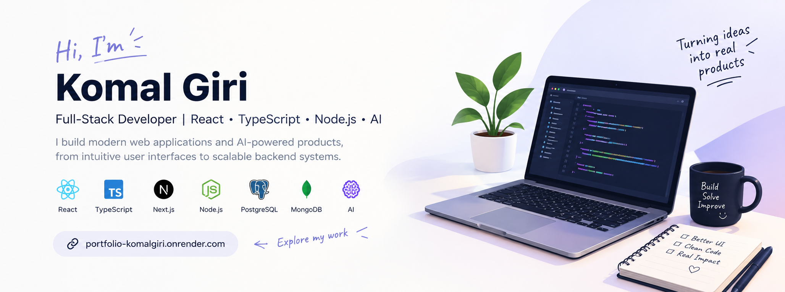
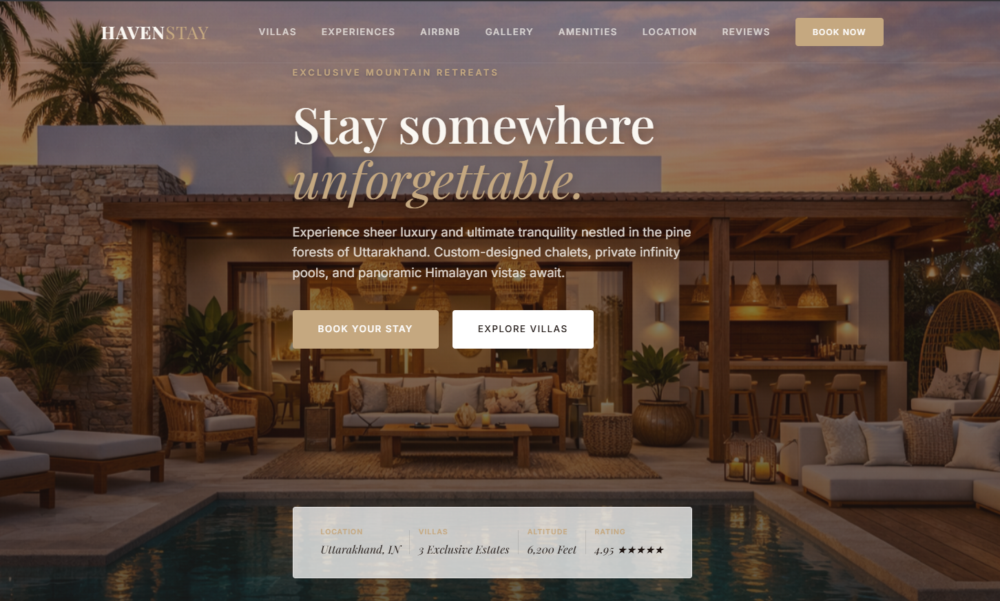
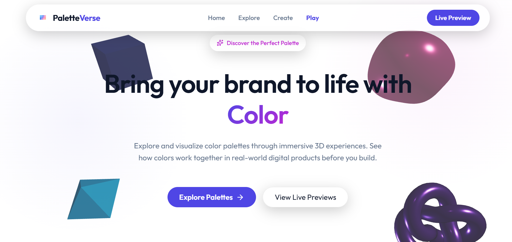
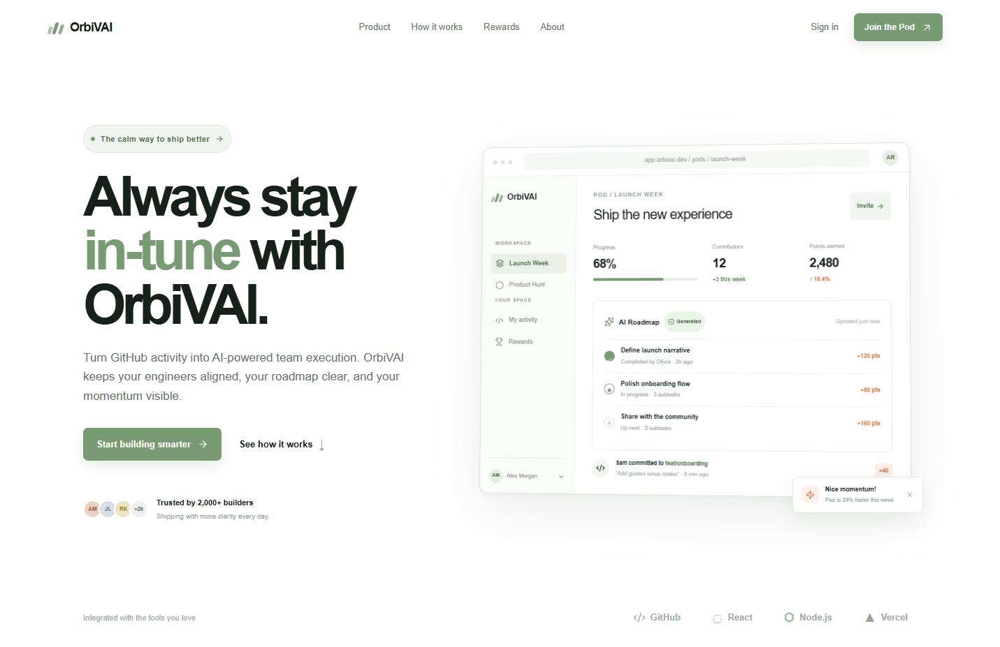
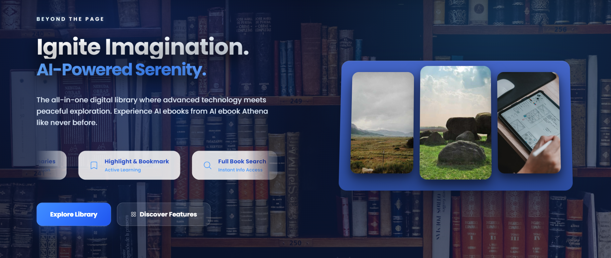

# Komal Giri — Developer Portfolio

[](https://portfolio-komalgiri.onrender.com/)
[](https://react.dev/)
[](https://www.typescriptlang.org/)
[](https://vitejs.dev/)
[](https://tailwindcss.com/)
[](https://nodejs.org/)
[](https://expressjs.com/)
[](#)

> Modern, high-performance personal portfolio and freelance client hub built for **Komal Giri** (Software Developer specializing in React, React Native, Node.js, and Full-Stack Engineering). Features deep-dive project case studies, interactive system architecture designs, mobile UI/UX galleries, dynamic GitHub analytics, and a dual-mode contact pipeline.

---

## 🌐 Live URL & Repository Identification

- **Production Live URL:** [https://portfolio-komalgiri.onrender.com/](https://portfolio-komalgiri.onrender.com/)
- **Active GitHub Repository:** [https://github.com/Komalgiri/Portfolio_Komalgiri](https://github.com/Komalgiri/Portfolio_Komalgiri)
- **Deployment Platform:** Render (Web Service auto-deploying from `main`)

> [!NOTE]
> **Repository Verification:** This repository (`Portfolio_Komalgiri`) is the **sole current production repository** powering the live portfolio at `portfolio-komalgiri.onrender.com`. Older local folders such as `Komalgiri_Portfolio` (an initial September 2025 commit) and `my-portfolio` (an earlier April 2026 local clone) have been superseded by this active repository with the latest freelance portal, case studies, and full-stack contact server.

---

## 📸 Visual Walkthrough & Screenshots

### Portfolio Overview & Hero


### Key Project & System Showcase

| Velora (Luxury E-Commerce & Mobile) | HavenStay (Vacation Rental & Booking) |
| :---: | :---: |
|  |  |

| PaletteVerse (Design System Tool) | OrbiVAI (AI Team Execution Platform) |
| :---: | :---: |
|  |  |

| System Architecture & UI/UX Gallery |
| :---: |
|  |

---

## 🛠️ Tech Stack

### Frontend & Client Experience
- **Framework & Runtime:** [React 19](https://react.dev/) with [TypeScript 5.9](https://www.typescriptlang.org/)
- **Build Tool & Bundler:** [Vite 7](https://vitejs.dev/) with `@vitejs/plugin-react` (Fast Refresh, optimized code chunks)
- **Styling & Design System:** [Tailwind CSS v3](https://tailwindcss.com/) with PostCSS & Autoprefixer
- **UI Components & Theming:** Custom CSS variables for seamless dark/light mode toggle (persisted via `localStorage`), glassmorphism frosted glass (`backdrop-blur`), and custom responsive layout containers
- **Motion & Micro-interactions:** [Framer Motion](https://www.framer.com/motion/) and custom `ScrollReveal` intersection observers
- **Icons:** [Lucide React](https://lucide.dev/) and [React Icons](https://react-icons.github.io/react-icons/) (Simple Icons, FontAwesome, Heroicons)
- **Visualizations & Charts:** [Recharts](https://recharts.org/) for GitHub footprint metrics and project analytics
- **Routing & Splitting:** Single-Page Architecture (SPA) with zero-latency hash & path routing (`#case-study/:id`, `#all-projects`, `#freelance`, `#system-design`, `#ui-design`, `#github-stats`) paired with React `lazy` and `Suspense` for asynchronous bundle loading

### Backend & Contact Service
- **Server:** [Express.js 5](https://expressjs.com/) on [Node.js](https://nodejs.org/) (ES Modules)
- **Email Delivery Service:** [Resend API](https://resend.com/) integration for direct email dispatch upon form submission
- **Serverless Fallback:** Google Apps Script integration (`VITE_CONTACT_SCRIPT_URL` + `VITE_CONTACT_SECRET`) for production serverless lead capture directly to Google Sheets
- **Local Persistence:** Local JSON ledger (`server/contacts.json`) for dev-mode submission debugging
- **Development Tooling:** [Concurrently](https://www.npmjs.com/package/concurrently) to run Vite client and Express server simultaneously

### SEO, Accessibility & Web Performance
- **Structured Data:** Full [Schema.org](https://schema.org/) JSON-LD annotations (`WebSite`, `ProfilePage`, `ProfessionalService`)
- **Metadata Management:** Dynamic `usePageMeta` hook updating document title, meta description, and OpenGraph tags per route
- **Discovery:** `sitemap.xml`, `robots.txt`, canonical URL tags, Google verification, and Twitter Summary Card cards
- **Accessibility:** Skip-to-content links, ARIA labels, semantic HTML5 landmarks, and high-contrast color tokens

---

## 🏗️ Architecture & How It's Built

```
                          ┌─────────────────────────────────────┐
                          │     Client (React 19 + Vite 7)      │
                          │   Dark/Light Theme · Glassmorphic   │
                          └──────────────────┬──────────────────┘
                                             │
             ┌───────────────────────────────┴───────────────────────────────┐
             ▼                                                               ▼
   ┌───────────────────┐                                           ┌───────────────────┐
   │    Main Routes    │                                           │   Lead Capture    │
   │  (Lazy Suspense)  │                                           │  (Contact Form)   │
   └─────────┬─────────┘                                           └─────────┬─────────┘
             │                                                               │
  ┌──────────┼──────────┬──────────┬──────────┐                              │
  ▼          ▼          ▼          ▼          ▼                              ▼
Home     Freelance  Case Study  System     UI/UX             ┌───────────────┴───────────────┐
Page      Portal     Deep-Dive   Design    Gallery           ▼                               ▼
                                                        [Local Dev]                    [Production]
                                                      Express 5 Server              Google Apps Script
                                                             │                               │
                                                      Resend API Email                Google Sheets
                                                             │                               │
                                                             ▼                               ▼
                                                    Developer Inbox                 Automated Alert
```

### 1. Dynamic Routing & Code Splitting
The portfolio utilizes a lightweight hash-and-pathname routing controller inside `src/App.tsx`. All secondary routes (`AllProjects`, `CaseStudy`, `FreelanceHome`, `GithubStats`, `SystemDesignGallery`, `UIDesignGallery`) are dynamically imported via `React.lazy()`:
- Keeps initial bundle weight minimal and fast-loading.
- Preserves smooth client transitions with custom fallback loaders (`PageLoader`).
- Allows deep-linking directly into specific project case studies (e.g. `/#case-study/velora`).

### 2. Dedicated Freelance Portal (`/#freelance`)
Designed specifically for startup founders, contract hirers, and US engineering teams:
- Showcases sprint offerings (React Native MVP, Full-Stack Web, Backend APIs, AI Integration).
- Features client feedback, deliverables checklist, time-zone overlap coverage (EST/PST), and instant booking CTAs.

### 3. Dual-Mode Contact Submission
The contact section (`src/components/home/Contact.tsx`) dynamically adapts based on environment configuration:
1. **Production Mode:** If `VITE_CONTACT_SCRIPT_URL` is set, requests are routed to Google Apps Script, logging inquiries directly into a secure spreadsheet and triggering email notifications without requiring a long-running Node container.
2. **Local Full-Stack Mode:** Posts to the Express API (`/api/contact`), validates fields, appends to `server/contacts.json`, and transmits an email via the Resend API.

---

## 📂 Project Directory Structure

```
Portfolio_Komalgiri/
├── public/                     # Static assets, favicon, sitemap, robots.txt, og-image
│   ├── icons/                  # Tech stack SVG brand icons
│   ├── favicon.svg             # Website favicon
│   ├── og-image.png            # OpenGraph social share card
│   ├── resume.pdf              # Downloadable resume
│   ├── robots.txt              # Search crawler directives
│   └── sitemap.xml             # Search engine sitemap
├── screenshots/                # Showcase captures for README & documentation
│   ├── portfolio-hero-banner.png
│   ├── velora-showcase.png
│   ├── havenstay-showcase.png
│   ├── paletteverse-showcase.png
│   ├── orbivai-showcase.png
│   └── ui-design-showcase.png
├── scripts/                    # Automation scripts
│   └── contact-form-apps-script.gs  # Google Apps Script email/sheets webhook
├── server/                     # Backend API server
│   ├── index.js                # Express 5 server with Resend email integration
│   └── contacts.json           # Local storage fallback for form submissions
├── src/
│   ├── assets/                 # High-resolution project imagery, videos, and badges
│   ├── components/
│   │   ├── home/               # Hero, About, Experience, Projects, GitHub, Contact, etc.
│   │   ├── layout/             # Responsive Navbar with mobile drawer & theme toggle
│   │   └── ui/                 # Reusable UI elements (ScrollReveal, modal, buttons)
│   ├── constants/              # Centralized data sources
│   │   ├── caseStudies.tsx     # Comprehensive project case study data
│   │   ├── projects.tsx        # Highlighted portfolio projects
│   │   ├── site.ts             # Site URL, SEO defaults, availability labels
│   │   ├── systemDesign.ts     # Architecture visual definitions
│   │   └── uiDesign.ts         # UI mockups & mobile showcase data
│   ├── context/                # Theme and state management providers
│   ├── hooks/                  # Custom React hooks (usePageMeta, etc.)
│   ├── pages/                  # Page-level components (Home, Freelance, CaseStudy, etc.)
│   ├── App.tsx                 # Main routing and dynamic suspense coordinator
│   ├── index.css               # Tailwind directives, theme tokens, and animations
│   └── main.tsx                # React DOM entry point
├── .env.example                # Template for environment variables
├── package.json                # Project dependencies and run scripts
├── tailwind.config.js          # Tailwind theme configuration
├── tsconfig.json               # TypeScript workspace config
└── vite.config.ts              # Vite configuration
```

---

## 🚀 Getting Started Locally

### Prerequisites
- [Node.js](https://nodejs.org/) (version 18 or higher recommended)
- `npm` (bundled with Node.js)

### 1. Clone the Repository
```bash
git clone https://github.com/Komalgiri/Portfolio_Komalgiri.git
cd Portfolio_Komalgiri
```

### 2. Install Dependencies
```bash
npm install
```

### 3. Configure Environment Variables
Create a `.env` file in the root directory by copying `.env.example`:
```bash
cp .env.example .env
```
Fill in your configuration:
```env
# Optional: Local Express + Resend email delivery (npm run server)
RESEND_API_KEY=re_your_resend_api_key
RESEND_FROM=Portfolio Contact <onboarding@resend.dev>
MAIL_TO=komalgiri789@gmail.com

# Optional: Serverless Google Apps Script webhook for production
VITE_CONTACT_SCRIPT_URL=https://script.google.com/macros/s/YOUR_DEPLOYMENT_ID/exec
VITE_CONTACT_SECRET=your_secret_passphrase
```

### 4. Run the Development Server

#### Run Full Stack (Vite Client + Express Backend):
```bash
npm run dev
# Starts client on http://localhost:5173
# Starts API server on http://localhost:3001
```

#### Run Frontend Only:
```bash
npm run client
```

#### Run Backend Server Only:
```bash
npm run server
```

### 5. Build for Production
To typecheck with TypeScript and produce an optimized production bundle in `/dist`:
```bash
npm run build
```

To preview the built production bundle locally:
```bash
npm run preview
```

---

## 🧭 Key Pages & Deep Links

- **Home:** `https://portfolio-komalgiri.onrender.com/`
- **Freelance & Contract Hub:** `https://portfolio-komalgiri.onrender.com/#freelance`
- **All Projects:** `https://portfolio-komalgiri.onrender.com/#all-projects`
- **OrbiVAI Case Study:** `https://portfolio-komalgiri.onrender.com/#case-study/codepod`
- **Velora Case Study:** `https://portfolio-komalgiri.onrender.com/#case-study/velora`
- **HavenStay Case Study:** `https://portfolio-komalgiri.onrender.com/#case-study/havenstay`
- **PaletteVerse Case Study:** `https://portfolio-komalgiri.onrender.com/#case-study/paletteverse`
- **System Design Gallery:** `https://portfolio-komalgiri.onrender.com/#system-design`
- **UI/UX Gallery:** `https://portfolio-komalgiri.onrender.com/#ui-design`
- **GitHub Footprint & Analytics:** `https://portfolio-komalgiri.onrender.com/#github-stats`

---

## 📬 Contact & Connect

**Komal Giri** — Software Developer  
*Specializing in React, React Native, Node.js, and Full-Stack Engineering*

- 🌐 **Portfolio:** [portfolio-komalgiri.onrender.com](https://portfolio-komalgiri.onrender.com/)
- 💼 **LinkedIn:** [linkedin.com/in/komalgiri](https://www.linkedin.com/in/komalgiri/)
- 🐙 **GitHub:** [github.com/Komalgiri](https://github.com/Komalgiri)
- ✉️ **Email:** [komalgiri789@gmail.com](mailto:komalgiri789@gmail.com)
- 📍 **Availability:** US Remote · Full-Time Roles & Freelance / Contract · EST/PST Overlap
