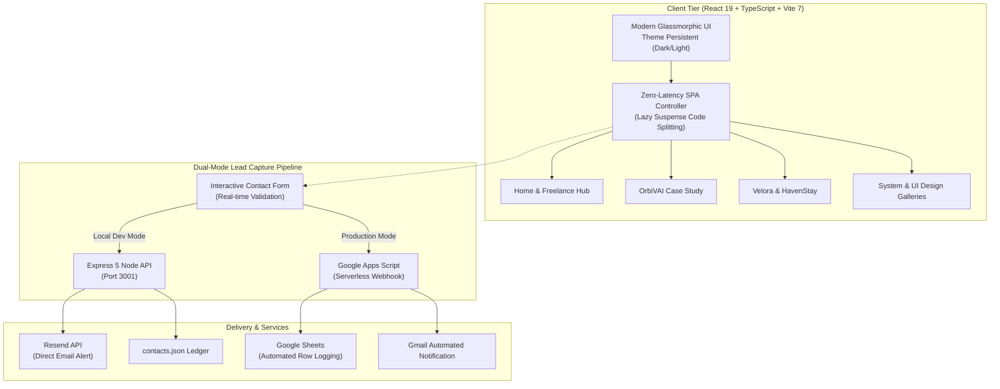

<div align="center">

# Komal Giri
### Full-Stack Engineer & Mobile App Architect
**React · React Native (iOS & Android) · TypeScript · Node.js · AI Integrations**

[](https://portfolio-komalgiri.onrender.com/)
[](#-contact--let's-collaborate)
[](https://www.linkedin.com/in/komalgiri/)
[](https://github.com/Komalgiri)
[](mailto:komalgiri789@gmail.com)

<br/>

<a href="https://portfolio-komalgiri.onrender.com/">
  
</a>

<br/><br/>

> *"I build modern web applications and AI-powered products, from intuitive user interfaces to scalable backend systems."*

[🚀 Explore Live Portfolio](https://portfolio-komalgiri.onrender.com/) • [💼 Freelance & Contract Hub](https://portfolio-komalgiri.onrender.com/#freelance) • [📄 Download Resume](https://portfolio-komalgiri.onrender.com/resume.pdf) • [📬 Schedule a Chat](mailto:komalgiri789@gmail.com)

</div>

---

## ⚡ Executive Summary

| Specialization | Key Highlights | Timezone / Availability |
| :--- | :--- | :--- |
| **Full-Stack Web** | React 19, TypeScript, Next.js, Node.js, Express 5, PostgreSQL, MongoDB, Prisma | **US Remote & International** |
| **Mobile Apps** | React Native, Expo, iOS & Android cross-platform native features, offline-first sync | **EST / PST Working Overlap** |
| **AI Workflows** | Google Gemini API, strategic project roadmaps, automated agents, predictive analysis | **Full-Time & Contract** |
| **Design Engineering** | Tailwind CSS v3, Framer Motion micro-interactions, WCAG compliance, dark/light systems | **Sprint-Ready Delivery** |

---

## 📸 Key Flagship Projects

<div align="center">

### 1. OrbiVAI — AI Team Collaboration & Execution Platform
*From GitHub activity to AI-powered team execution — Pod workspaces, Gemini roadmaps, task boards, and developer rewards.*

[](https://portfolio-komalgiri.onrender.com/#case-study/codepod)

[🔗 Case Study Deep-Dive](https://portfolio-komalgiri.onrender.com/#case-study/codepod) • [🐙 GitHub Repository](https://github.com/Komalgiri/codepods-backend)

</div>

<br/>

| Velora (Luxury Fashion E-Commerce & Mobile) | HavenStay (Modern Property Rental & Booking) |
| :---: | :---: |
| [](https://portfolio-komalgiri.onrender.com/#case-study/velora) | [](https://portfolio-komalgiri.onrender.com/#case-study/havenstay) |
| **Tech:** React, Redux Toolkit, Node.js, Stripe, Tailwind CSS<br/>[📖 Explore Velora Case Study](https://portfolio-komalgiri.onrender.com/#case-study/velora) | **Tech:** React, Express, MongoDB, Cloudinary, JWT<br/>[📖 Explore HavenStay Case Study](https://portfolio-komalgiri.onrender.com/#case-study/havenstay) |

| PaletteVerse (Design Tool & WCAG Color Suite) | System Architecture & Interactive UI Gallery |
| :---: | :---: |
| [](https://portfolio-komalgiri.onrender.com/#case-study/paletteverse) | [](https://portfolio-komalgiri.onrender.com/#system-design) |
| **Tech:** React, HTML5 Canvas API, Tailwind CSS, Mini-Games<br/>[📖 Explore PaletteVerse Case Study](https://portfolio-komalgiri.onrender.com/#case-study/paletteverse) | **Interactive Visuals:** Architecture schemas & mobile prototypes<br/>[🏛️ Explore System Design Gallery](https://portfolio-komalgiri.onrender.com/#system-design) |

---

## 🛠️ Technical Skills Matrix

```
Languages:        TypeScript (ESNext) · JavaScript · Python · SQL · HTML5 · CSS3
Frontend:         React 19 · Next.js · Vite 7 · Redux Toolkit · Zustand · Tailwind CSS · Framer Motion
Mobile:           React Native · Expo · Android Studio · iOS CocoaPods · Native Device APIs
Backend:          Node.js · Express.js 5 · RESTful APIs · WebSockets · JWT Authentication
Databases:        PostgreSQL · MongoDB · Prisma ORM · Firebase / Firestore · Supabase
AI & Services:    Google Gemini API · GitHub REST / Octokit · Resend API · Stripe Payment Processing
DevOps:           Docker · Git / GitHub Actions · Render · Vercel · Postman · Linux
```

---

## 🏗️ Architecture & Engineering Highlights



### Key Engineering Standards:
- **Zero-Friction Code Splitting:** Secondary routes (`AllProjects`, `CaseStudy`, `FreelanceHome`, `GithubStats`, `SystemDesignGallery`, `UIDesignGallery`) load asynchronously via `React.lazy()` with tailored spinner fallbacks.
- **Robust Lead Pipeline:** Supports both local full-stack execution with an Express 5 daemon + Resend API, and zero-maintenance production serverless logging via secure Google Apps Script webhooks.
- **Persistent Theming:** Instant light/dark mode toggling using CSS custom properties with zero flash of unstyled content (FOUC).
- **Dominant SEO Engine:** Complete [Schema.org](https://schema.org/) JSON-LD structure (`WebSite`, `ProfilePage`, `Person`, `ProfessionalService`, `ItemList`), OpenGraph cards, Twitter cards, canonical tags, automated sitemaps, and robots directives.

---

## 📁 Repository Structure

```
Portfolio_Komalgiri/
├── public/                          # Static assets, favicon, sitemap, robots.txt, og-image
│   ├── favicon.svg                  # Brand favicon
│   ├── og-image.png                 # 1200x630 OpenGraph social preview
│   ├── resume.pdf                   # Downloadable resume
│   ├── robots.txt                   # Crawler indexing rules
│   └── sitemap.xml                  # Multi-page search engine index
├── screenshots/                     # Curated showcases for documentation & previews
│   ├── portfolio-hero-banner.png    # High-resolution hero banner
│   ├── orbivai-showcase.png         # OrbiVAI team execution platform
│   ├── velora-showcase.png          # Velora luxury storefront
│   ├── havenstay-showcase.png       # HavenStay property rental
│   ├── paletteverse-showcase.png    # PaletteVerse color tool
│   └── ui-design-showcase.png       # System design & mobile prototypes
├── scripts/                         # Automation & serverless utilities
│   └── contact-form-apps-script.gs  # Google Apps Script webhook integration
├── server/                          # Local backend engine
│   ├── index.js                     # Express 5 server with Resend email integration
│   └── contacts.json                # Local fallback ledger
├── src/
│   ├── assets/                      # Production imagery, icons, and video showcases
│   ├── components/
│   │   ├── home/                    # Hero, About, Experience, Projects, GitHub, Contact
│   │   ├── layout/                  # Responsive Navbar with mobile drawer & theme toggle
│   │   └── ui/                      # Reusable UI elements (ScrollReveal, modals, buttons)
│   ├── constants/                   # Data sources (case studies, system design, site SEO)
│   ├── hooks/                       # Custom hooks (usePageMeta dynamic SEO)
│   ├── pages/                       # Route components (Home, Freelance, CaseStudy, etc.)
│   ├── App.tsx                      # Main routing coordinator with Suspense
│   ├── index.css                    # Tailwind directives & theme design tokens
│   └── main.tsx                     # React 19 entry point
├── package.json                     # Scripts & dependencies
└── vite.config.ts                   # Vite build configuration
```

---

## 🚀 Local Development Setup

### 1. Prerequisites
- **Node.js** (v18.0.0 or higher)
- **npm** (bundled with Node.js)

### 2. Clone & Install
```bash
git clone https://github.com/Komalgiri/Portfolio_Komalgiri.git
cd Portfolio_Komalgiri
npm install
```

### 3. Configure Environment Variables
```bash
cp .env.example .env
```
Configure your keys in `.env` (optional for local testing):
```env
# Optional: Local Express + Resend email service
RESEND_API_KEY=re_your_resend_api_key
RESEND_FROM=Portfolio Contact <onboarding@resend.dev>
MAIL_TO=komalgiri789@gmail.com

# Optional: Serverless Google Apps Script webhook
VITE_CONTACT_SCRIPT_URL=https://script.google.com/macros/s/YOUR_DEPLOYMENT_ID/exec
VITE_CONTACT_SECRET=your_secret_passphrase
```

### 4. Run the Dev Environment
```bash
# Run both Client (5173) and Server (3001) concurrently
npm run dev

# Or run frontend client only
npm run client

# Or run backend API only
npm run server
```

### 5. Production Build
```bash
# Typecheck with TypeScript and compile optimized chunks into /dist
npm run build

# Preview production build locally
npm run preview
```

---

## 🧭 Direct Navigation Links

- 🌐 **Home Page:** [portfolio-komalgiri.onrender.com](https://portfolio-komalgiri.onrender.com/)
- 💼 **Freelance & Services Hub:** [/#freelance](https://portfolio-komalgiri.onrender.com/#freelance)
- 🚀 **OrbiVAI Case Study:** [/#case-study/codepod](https://portfolio-komalgiri.onrender.com/#case-study/codepod)
- 🛍️ **Velora Case Study:** [/#case-study/velora](https://portfolio-komalgiri.onrender.com/#case-study/velora)
- 🏡 **HavenStay Case Study:** [/#case-study/havenstay](https://portfolio-komalgiri.onrender.com/#case-study/havenstay)
- 🎨 **PaletteVerse Case Study:** [/#case-study/paletteverse](https://portfolio-komalgiri.onrender.com/#case-study/paletteverse)
- 🏛️ **System Design Gallery:** [/#system-design](https://portfolio-komalgiri.onrender.com/#system-design)
- 📱 **UI/UX Design Showcase:** [/#ui-design](https://portfolio-komalgiri.onrender.com/#ui-design)
- 📊 **GitHub Activity & Footprint:** [/#github-stats](https://portfolio-komalgiri.onrender.com/#github-stats)

---

## 📬 Contact & Let's Collaborate

I am actively open to **full-time software engineering roles**, **US remote contract positions**, and **startup MVP sprints**.

- 💼 **LinkedIn:** [linkedin.com/in/komalgiri](https://www.linkedin.com/in/komalgiri/)
- 🐙 **GitHub:** [github.com/Komalgiri](https://github.com/Komalgiri)
- ✉️ **Direct Email:** [komalgiri789@gmail.com](mailto:komalgiri789@gmail.com)
- 🌐 **Website:** [portfolio-komalgiri.onrender.com](https://portfolio-komalgiri.onrender.com/)
- 📍 **Availability:** US Remote · Full EST / PST Timezone Overlap
